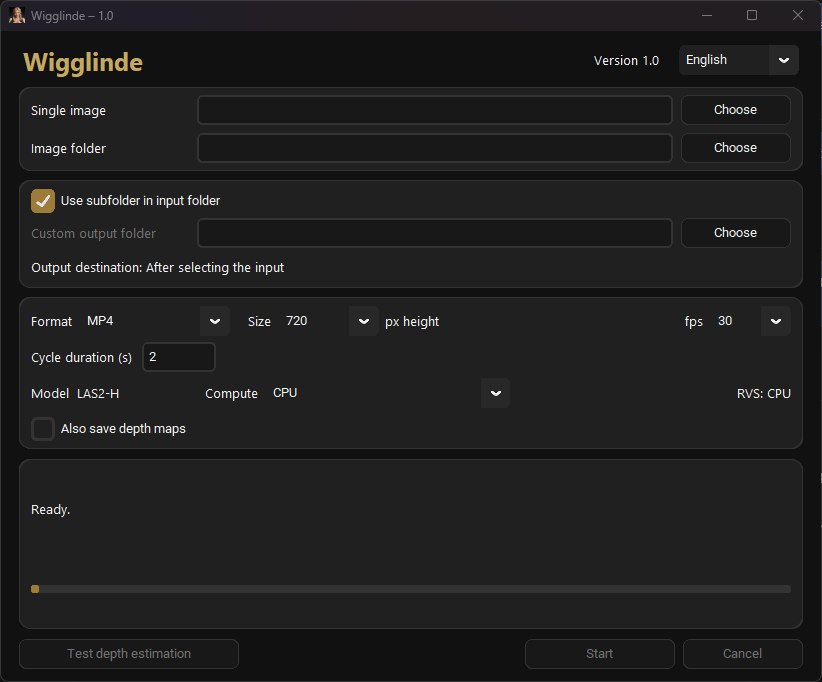

# Wigglinde 1.1

[Downloads and SHA-256](https://github.com/muelli1975/Wigglinde/releases/tag/v1.1) · [Deutsch](README_DE.md)

Wigglinde is a local tool for creating wiggle animations from already
aligned Full-SBS stereo photographs. It estimates depth from the existing left
and right views with **Lite Any Stereo V2 H (LAS2-H)** or **IGEV++ Middlebury** and renders
intermediate views with **MPEG-I RVS**.

Processing runs locally, without an account, cloud or tracking. The portable
package includes the model and runtimes; no automatic downloads are required.
The interface is available in German and English.

## Requirements and installation

- Windows 10 or 11, 64-bit; or Linux x64 (Ubuntu 22.04 or newer); or macOS 15 or newer, with separate Apple Silicon and Intel packages.
- CPU processing is supported on all three systems. On Windows, compatible NVIDIA, AMD and Intel graphics cards
  with a DirectX 12 driver can accelerate depth estimation through DirectML.
- No separate Python installation, CUDA toolkit or build tools are required.

Extract [Wigglinde_1.1_Windows_x64.zip](https://github.com/muelli1975/Wigglinde/releases/download/v1.1/Wigglinde_1.1_Windows_x64.zip) and start `Wigglinde\Wigglinde.exe`.
On Linux extract [Wigglinde_1.1_Linux_x64.tar.gz](https://github.com/muelli1975/Wigglinde/releases/download/v1.1/Wigglinde_1.1_Linux_x64.tar.gz) and start `Wigglinde/Wigglinde`.
On macOS extract the matching [Wigglinde_1.1_macOS_AppleSilicon.zip](https://github.com/muelli1975/Wigglinde/releases/download/v1.1/Wigglinde_1.1_macOS_AppleSilicon.zip) or
[Wigglinde_1.1_macOS_Intel.zip](https://github.com/muelli1975/Wigglinde/releases/download/v1.1/Wigglinde_1.1_macOS_Intel.zip) and open `Wigglinde/Wigglinde.app`.
The macOS apps are ad-hoc signed, without Apple notarization; macOS may require
approval in **System Settings → Privacy & Security → Open Anyway** after first launch.
Keep the complete application folder together, including models and assets beside
the macOS app. Processing works offline. Linux completion audio uses `paplay`
or `aplay` when installed. Linux and macOS use CPU/Float32 only.

## Basic use

1. Select a single image or an image folder. Only images directly inside the
   selected folder are processed; subfolders are ignored.
2. Use an output folder beside the input or select a custom output folder.
3. Choose format, size, frame rate and cycle duration.
4. Choose **LAS2-H** (default) or **IGEV++ Middlebury**.
5. Optionally enable **Also save depth maps**.
6. Choose CPU or a graphics adapter and click **Start**.

Input must be Full-SBS: the normal-width left half followed by the right half.
Wigglinde does not align images, swap views, crop the source or adjust convergence.
Supported formats are JPEG, PNG, TIFF, BMP and WebP with opaque 8-bit RGB or grayscale
pixels. EXIF orientation and embedded colour profiles are respected.

First-launch defaults: **LAS2-H, MP4, 720p, 30 fps, two-second cycle and CPU**.
Smaller inputs are not enlarged. Aspect ratio and full image borders are preserved;
images are reduced with Lanczos before depth estimation.

## Animation output

| Format | Maximum size | Frame rate | Playback |
| --- | --- | --- | --- |
| MP4 | 720 / 1080 / 2160 pixels high | 30 / 60 fps | Five cycles |
| WebP | 720 / 1080 / 2160 pixels high | 30 / 60 fps | Infinite loop; quality 85 |
| AVIF | 720 / 1080 / 2160 pixels high | 30 / 60 fps | Infinite loop; quality 60, 4:4:4 |
| GIF | 640 / 800 / 1024 pixels on the long edge | 10 / 15 / 20 / 25 fps | Infinite loop |
| PNG sequence | 1080 / 2160 pixels high | 30 / 60 fps | One numbered cycle |

Cycle duration is adjustable from 0.5 to 30 seconds. Motion is sinusoidal, without
a duplicated final endpoint. The return path and repeated cycles reuse the same
rendered views. MP4 uses H.264 CRF 18/slow; GIF uses a shared palette for the whole
cycle. Odd MP4 dimensions are padded by at most one black row/column, without cropping.

LAS2-H is the established default and uses four fixed iterations. IGEV++ Middlebury
uses sixteen fixed iterations and is a slower alternative for difficult structures,
such as railings. Results depend on the photograph; neither model is always better.
CPU uses Float32; GPU uses a separate mixed Float16/Float32
model, retaining selected normalization, probability, summation and sampling operations
in Float32. **RVS renders on CPU in both modes**, using Precision 1, RGB and
Simple blending with factor 5. Independent views run in parallel within CPU and memory limits.

Large images require more memory. Mixed precision does not guarantee that 2160p fits
on every GPU. Memory errors do not silently change the selected device, model,
resolution or precision. Fine structures, occlusions, glass and reflections can
still produce doubled contours or transition artifacts.

WebP and AVIF default to 720p at 30 fps and loop continuously.

## Output and depth maps

The default destination is `output` beside the selected image or inside the selected
image folder. A custom destination can be used instead.

| Folder | Contents |
| --- | --- |
| `wiggle` | MP4, GIF, WebP, AVIF or a folder for each PNG sequence |
| `depth_maps` | Optional left/right 16-bit PNG depth maps and scale metadata |
| `_temp` | Temporary working files, removed after processing |

Names retain the original stem, for example `Image_wiggle_30fps_720p_las2-h.mp4`, without
source-folder prefixes. Suffixes are lowercase. The fixed model suffix is `las2-h` or `igev-middlebury`,
including GIFs, PNG-sequence folders and depth maps, so both model results can coexist.
For example: `Image_depth_720p_igev-middlebury_left.png`.
Finished animations are replaced
only after a successful export. **Cancel** stops processing; completed files remain.
Originals are never changed. An empty `_temp` folder is removed as well.

**Also save depth maps** uses the already calculated maps, without another model run.
Each map belongs to its corresponding left/right image half at the processing size.
Both share a linear scale: white is near, black is far. They contain **relative
disparity, not distance in metres**. A JSON companion records the scale, decoding formula, model, iteration count,
precision and processing device. No lenticular print preparation is included.

## Settings and diagnostics

Language, model, device, last input paths, output mode/folder, depth-map option and animation
settings are saved in `settings.json` beside the program. Keep this file when updating.
Restored input paths do not start processing automatically.

**Test depth estimation** processes a selected single image without rendering or
saving maps. Choose the output size first. Logs record timing, precision and sampled
memory use. `logs/latest_run.json` is overwritten each run. The ongoing logs rotate
at 5 MiB with three backups each. No full output-decode checks run during normal batches.

## Source code and long-term use

The repository contains the application source and build instructions. See
[BUILD.md](BUILD.md) for source use and portable builds, and
[development notes](docs/DEVELOPMENT.md) for validation details. The release includes
its matching source in `source` and third-party notices in `licenses`.

Wigglinde is intended to remain understandable and usable for future development
and the stereoscopic community. Active maintenance, support, issue handling or
pull-request review cannot be guaranteed.

## License

Original Wigglinde code and documentation by Christoph Müller use the
[MIT License](LICENSE). Third-party software and model weights retain their own
licenses. See [THIRD_PARTY.md](THIRD_PARTY.md).
